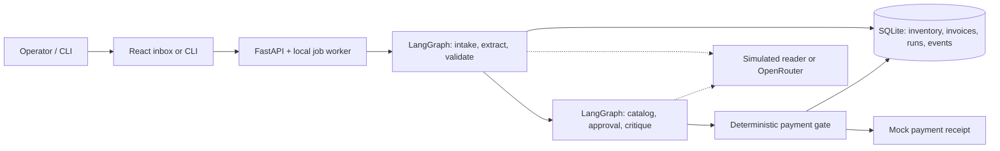

# Invoice Desk

A local invoice-processing prototype for the fictional Acme Corp case. It reads invoices, checks items against SQLite inventory, explains exceptions, runs a simulated approval and critique, and records a **mock** payment only after deterministic checks pass. A React inbox lets an operator inspect source text, findings, decisions and receipts.

The sidebar includes System design and Presentation for a walkthrough of the current architecture, agent roles, sample scenarios and limitations. The sidebar also offers an interactive Guided walkthrough and a saved light/dark preference. The guide highlights real controls and waits for explicit processing; it does not submit review decisions. Light is the default. Held invoices put the review decision and blockers first; the source document remains available alongside them.


[See the guided walkthrough](frontend/docs/screenshots/guided-walkthrough.png).

> **Mode matters:** the default offline `mock` mode uses a deterministic simulated reader, not a language model. An OpenRouter adapter is implemented for a real model. One clean invoice passed a live Grok 4.7 test; broader live-model accuracy is unverified. Mock mode demonstrates the case's local simulated workflow; it does not measure genuine LLM reasoning or extraction accuracy. OpenRouter needs internet, and a local LLM is not configured.

## Quick start

Requirements: Python 3.12, [uv](https://docs.astral.sh/uv/), Node 22 and npm. Commands run from the repository root.

```bash
# Install the locked Python dependencies.
uv sync --locked --python 3.12

# Process one supplied file. The default mock mode uses no API key.
MODEL_MODE=mock uv run python main.py --invoice_path=data/invoices/invoice_1001.txt

# Optional: process the supplied files as a batch on the same SQLite ledger.
MODEL_MODE=mock uv run python main.py --batch=data/invoices
```

The command prints the run stages, findings, decision and mock receipt. A valid rejection or review hold is a successful execution. Use `--json` for a JSON result on standard output; human-readable logging goes to standard error. On a persistent ledger, running the same invoice again may return a duplicate instead of a new payment. Set `DATA_DIR` to an empty directory for a fresh ledger. Never reset a ledger containing information you need.

## Run the interface

```bash
cd frontend
npm ci
npm run build
cd ..
MODEL_MODE=mock uv run python -m invoice_flow.server
```

Open **http://127.0.0.1:8000**. Select **New invoice**, then upload a file or choose a supplied sample. Open a finished run to see source text, extracted fields, findings, readable activity and the JSON trace. Print decision report and Print activity report open branded browser print views that can be saved as PDFs; Download report CSV provides recorded decision details as a spreadsheet. Download trace JSON retains the technical export. Find invoice searches the current workspace ledger by invoice number, and records can link to related versions. Ledger overview shows workspace-wide counts and simulated receipts grouped by currency, with date, vendor and outcome filters, plus charts for outcomes (failed runs and batch extraction steps shown separately), run dates and vendor activity, and a table of distinct invoices, runs and identity holds by type. Inbox status counts stay on the Invoices page rather than being repeated there. Assigned shows review holds with a recorded handoff, separate from the unassigned Needs review view; no team notification is sent and payment stays on hold. In the inbox, use Duplicates to find loaded runs marked as duplicate submissions. Select loaded runs individually or select the visible rows, then export the selection as CSV or record department handoffs for eligible review holds. Bulk handoffs do not notify a team or authorize payment; each run is checked separately and results are reported individually. Rejected invoices include a copyable correction request and an explicit corrected-file action; the app does not send messages. Failed or interrupted runs can be retried as linked attempts. A simulated reviewer can resolve server-permitted findings with a selected reason and an optional note; the server checks the content and policy again before recording a mock payment.

Local browser sessions retain their signing key in the data directory, so a restart preserves access while the cookie remains valid. Keep that private key with any database backup; deleting it or changing `SESSION_SECRET` invalidates existing sessions. Newly loaded PDFs retain their original bytes as well as extracted text. The invoice record can switch between those views and locate finding evidence in the text.

For frontend development, run `npm run dev` in `frontend/` while the backend runs on port 8000. The development proxy preserves the browser host for the same-origin check. No invoice is processed just by opening the page.

## What the system does

| Case requirement | Implementation | Evidence and limits |
| --- | --- | --- |
| Read invoices in several formats | PDF/TXT text extraction, structured CSV/JSON/XML parsing and a model-provider interface | 20 supplied files exercised in mock mode. Image-only PDFs are rejected; OCR is not included. |
| Validate against SQLite inventory | Quantity aggregation, item lookup, arithmetic, dates and currency checks | Unit tests and the 20-case regression; inventory is a fixed mock snapshot. |
| Simulate VP approval and critique | Separate LangGraph preparation and decision graphs, typed tool calls and bounded revision | Controlled-provider and simulated-reader tests. Real model performance is unverified. |
| Process or reject | Transactional payment gate and simulated receipt; recorded rejection reasons | Duplicate/revision, stale approval and browser tests. No real bank API is called. |
| LLM integration | Configurable OpenRouter Chat Completions adapter | One clean-invoice live Grok test passed, including an inventory tool call. Broader live evaluation remains open. |
| Local CLI and readable interface | `main.py`, FastAPI, React and SQLite | CLI, API and browser tests in mock mode. |

## Architecture



The CLI and web app share the same service and payment gate. Invoice content is treated as data, not trusted instructions. Invoices are grouped by vendor and invoice number; revisions and duplicate submissions cannot cause a second mock payment for the same payable. See [architecture](docs/architecture.md) and [policy decisions](docs/decisions.md).

Batch preparation is reused for decisions using the same document hash. Conflicting versions stay held across later submissions until a simulated reviewer explicitly selects a valid unpaid version; selecting one supersedes its alternatives. Validation checks source support for dates/revisions and nonnegative tax. Cancellation and the run deadline are checked again before payment.

## Model modes

- **`mock`**: default, offline and zero-key. A deterministic simulated provider demonstrates extraction and agent flow. It is not an LLM and cannot establish model accuracy.
- **`live`**: explicitly select `--mode live` or `MODEL_MODE=live`, provide `OPENROUTER_API_KEY` and a positive `MODEL_BUDGET_USD`, and configure `LLM_MODEL` if needed. The candidate default is `x-ai/grok-4.7`. One live clean-invoice run succeeded; model availability, broader behavior and future pricing can vary. Live errors never silently fall back to mock. Set a **provider-side key limit**: the application cap only counts reported costs, and missing usage cost is unknown.

Use shell environment variables or your platform's secret store; `.env.example` is a reference and is not automatically loaded. Never commit credentials. Hosted browser sessions only offer mock mode by default.

## Checks and evaluation

```bash
uv run ruff check .
uv run ruff format --check .
uv run python scripts/export_openapi.py --check
uv run pytest
uv run python scripts/evaluate_samples.py
cd frontend
npm run typecheck && npm run lint && npm test && npm run build
npx playwright install chromium
npm run test:e2e
```

The offline regression compares all 20 supplied files with predefined expected outcomes on a fresh ledger per file. It is a **known regression set using a simulated reader**, not an independent or blind estimate of LLM accuracy. Additional authored fixtures check fields and outcomes for new layouts, an unknown item, arithmetic errors, and above-threshold scrutiny. A batch uses a shared ledger and groups revisions/duplicates before payment. See [evaluation results](docs/evaluation.md), including case-level output and known gaps. Live tests are disabled by default and require explicit opt-in, credentials and a budget. The positive live test requires a successful paid clean invoice, actual inventory tool use, and approval/critique records; provider failures cannot count as success.

## Container and optional hosting

The [Dockerfile](Dockerfile) builds the React app and Python service into one image. `render.yaml` configures an optional single-instance free Render service with mock mode, a passcode, and **ephemeral storage**. The original case says local operation and no cloud deployment; hosting is an optional supplement, not a replacement for the requested repository and local run. No hosted deployment is claimed here. See [deployment](docs/deployment.md) for a local container test, persistence and rollback details.

## Important limitations

This is a prototype: no real payment, email, ERP, FX or vendor-master integration; no OCR; one server process; and no production load or accessibility conformance claim. Historical PDF records created before original-byte retention keep their extracted text; recovering their originals requires loading those documents again. Batches interrupted by server restart do not automatically recover. [Full limitations and policy choices](docs/decisions.md) are documented.

The sample files are from the [Galatiq case repository](https://github.com/galatiq-ai/galatiq-case-invoices), as recorded in [SOURCE.md](data/invoices/SOURCE.md). Developed with AI coding assistance; the implementation, tests and limitations are available for review.
