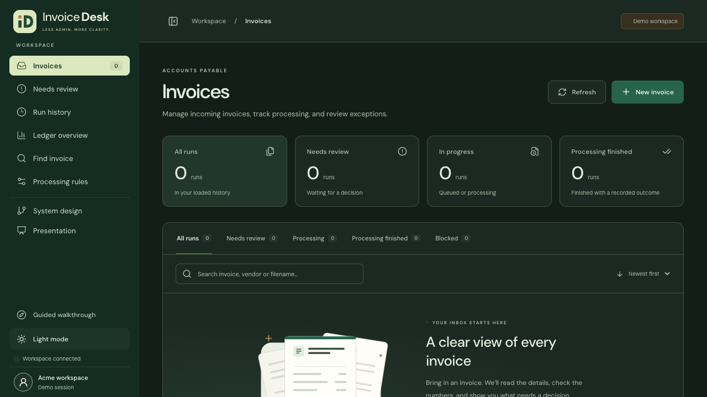
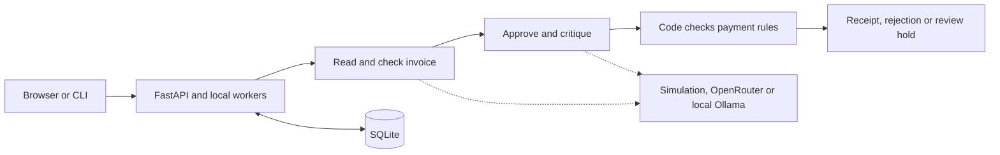

# Invoice Desk

Invoice Desk helps an accounts-payable team answer three questions: **What does this invoice say? Is it valid? What should happen next?**

Built for Galatiq’s fictional Acme Corp case, it reads invoices, checks them against inventory, runs an approval and a separate review of that approval, and records a simulated payment when the checks pass. Invoices with problems show a reason and a next step.



**Start here:** [Run locally](#run-locally) · [Try the demo](#try-the-demo) · [Requirements](#how-it-meets-the-case-requirements) · [Test results](#tests-and-results)

## Run locally

You need **Python 3.12, uv, Node 22 and npm**. Run these commands from the repository root:

```bash
uv sync --locked --python 3.12
npm --prefix frontend ci
npm --prefix frontend run build
MODEL_MODE=mock uv run python -m invoice_flow.server
```

Open **http://127.0.0.1:8000**. No API key is needed for this default mode. It uses simulated model responses, so it demonstrates the workflow without making paid calls.

Prefer the terminal? The same processing logic is available through the CLI:

```bash
uv run python main.py --mode mock --invoice_path=data/invoices/invoice_1001.txt
uv run python main.py --mode mock --batch=data/invoices
```

A rejected invoice is a valid business result, not a program crash. Running an invoice again may show it as a duplicate; it does not create another payment.

## Try the demo

1. Open **New invoice** and choose **Sample invoices**.
2. Select one of the files below and process it.
3. Open the source, check the findings, then inspect the decision and activity.

| File | What to look for in simulated mode |
| --- | --- |
| `invoice_1001.txt` | A valid invoice reaches approval and receives a simulated receipt. |
| `invoice_1003.txt` | An invalid invoice is rejected with reasons. |
| `invoice_1012.txt` | A vendor-name change needs a person to review it. |

The **Guided walkthrough** in the sidebar points out the actual controls. It waits for your actions and does not approve invoices for you. **System design** explains the flow, and **Presentation** provides a short, full-screen walkthrough.

## How it meets the case requirements

| Requirement | What is implemented |
| --- | --- |
| Read invoices in different formats | PDF, TXT, CSV, JSON and XML. CSV supports comma, semicolon and tab separators. |
| Extract and validate data | Required fields, totals, quantities, inventory, dates and currency checks. The original source remains available. |
| Use multiple agents | Separate reader, validator, approver and critic roles, coordinated with LangGraph. |
| Simulate approval and review | The approver proposes a decision; the critic checks it. One revision is allowed before unresolved disagreements go to a person. |
| Process payments or reject invoices | Code rechecks the rules before recording a simulated receipt. Rejections and holds retain their reasons. |
| Run locally | Both the browser interface and CLI use the same Python service and SQLite database. |

### What makes it multi-agent?

Each role has a different job and exchanges results in a checked format:

- **Reader:** extracts invoice fields from PDF or text. Structured files are read directly by code.
- **Validator:** requests an inventory lookup. Python also checks the arithmetic and other rules independently.
- **Approver:** proposes whether to approve, reject or request review.
- **Critic:** challenges that proposal and can request a revision.

These roles can share one model. They are separate steps, not four parallel services. Invalid invoices can stop early. A model’s approval alone cannot authorize payment.

## Useful additions

- **Review and handoffs:** choose a reason, add an optional note, or assign an invoice to a department. Assignment does not authorize payment or send a notification.
- **Corrections and retries:** submit a corrected file or retry failed work while keeping the original record.
- **Analytics:** charts show outcomes, activity, review backlog and blocking reasons. Open matching records and filter by date, vendor or processing result.
- **Reports:** save branded decision and activity PDFs through the browser print dialog, or export CSV. Technical JSON is available in Developer mode.
- **Usability:** light/dark themes, a collapsible sidebar, invoice search, multi-select and four review panels that scroll independently.

## How the system fits together



**Stack:** React and TypeScript for the interface; FastAPI and Python for the API and checks; LangGraph for the agent flow; SQLite for inventory, invoices, jobs and history. Docker packages the app into one service.

Duplicate files and revisions are checked before payment. Queued batches resume after restart; work interrupted mid-processing requires an explicit rerun. Existing receipts remain protected from a second payment. Workspace reset is blocked while work is active.

[Detailed architecture](docs/architecture.md) · [Rules and design decisions](docs/decisions.md)

## Model options

| Option | When to use it |
| --- | --- |
| **Simulated, default** | Run the app offline without a key or provider charges. This does not test real model reasoning. |
| **OpenRouter with Grok 4.7** | Use real model responses. Set `OPENROUTER_API_KEY` and a positive `MODEL_BUDGET_USD`, then use `--mode live` in the CLI. Internet and provider credit are required. |
| **Local Ollama, experimental** | Run an installed tool-capable model with `LLM_PROVIDER=ollama`. Start the daemon with `OLLAMA_NO_CLOUD=1`. Tested Qwen models held clean invoices unnecessarily, so this is not the recommended demo option. |

Configuration is listed in [.env.example](.env.example); the app reads environment variables and does not load that file automatically. Live errors remain visible rather than silently switching to simulation. Set a provider-side spending limit too: the application cannot count costs the provider does not report.

## Tests and results

| Check | Recorded result |
| --- | --- |
| Backend tests | **779 passed**; four paid tests excluded from the default run |
| Frontend tests | **81 passed** |
| Browser tests | **21 passed** |
| Supplied sample files | **20/20 expected outcomes** using simulated responses |
| Grok rerun with corrected policy label | **16/16 expected matches** across ten known scenarios; three scenarios were each run three times |

The latest Grok rerun cost **$0.198862**, with no unsafe payments observed. Before rerunning, the missing-vendor expectation was corrected and committed to match the existing rejection policy. The original inputs and earlier results remain in the evaluation record. This is a known-case check, not a general accuracy guarantee.

```bash
uv run pytest
uv run ruff check .
uv run ruff format --check .
uv run python scripts/export_openapi.py --check
npm --prefix frontend test
npm --prefix frontend run lint
npm --prefix frontend run build
# Install Chromium once before the browser tests:
cd frontend
npx playwright install chromium
npm run test:e2e
```

[Evaluation details and evidence](docs/evaluation.md)

## Deployment and limits

- **`main`** is the reviewed product. **`deployment`** is the hosting release branch. Shared fixes go into main first, then are merged into deployment.
- Render configuration is prepared, but a live hosted service has not been verified. The free configuration uses simulation and temporary storage, so records can be lost when the service restarts.
- The case asks for local execution. Hosting is an optional supplement.
- Payments, approvals and inventory are simulated. No bank, ERP, email or vendor-master service is connected.
- Scanned pages need OCR, which is not included. A scan inside a text PDF is reported rather than silently skipped.
- Run one server process. Distributed recovery, production load and accessibility conformance have not been verified.

[Deployment instructions](docs/deployment.md) · [Full limitations](docs/decisions.md)

Sample invoices come from the [Galatiq case repository](https://github.com/galatiq-ai/galatiq-case-invoices), as recorded in [SOURCE.md](data/invoices/SOURCE.md). Built with AI coding assistance.
