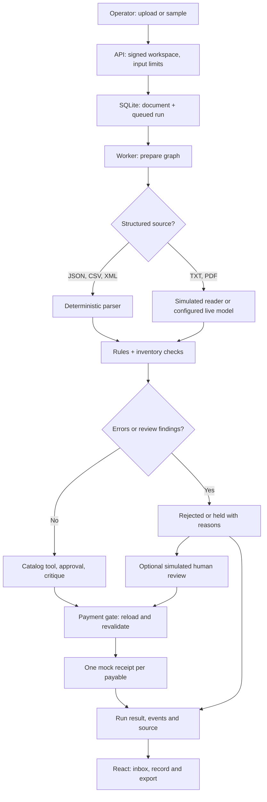

# Architecture and flow

## Scope

Invoice Desk is a single-process prototype. React provides an accounts-payable inbox; FastAPI serves its API and the built frontend. The CLI and API share `service.py`, the same policy and the same SQLite-backed payment gate. Inventory, the VP, the reviewer and payment are simulations.

## Upload and validation

The API checks the filename, extension, size and content; parses structured files directly; and extracts text from TXT and text-based PDF files. The model-facing path returns a typed draft. Rules compare amounts, field-specific dates/revisions, and quoted repairs to the source, aggregate quantities for inventory checks, validate derived charges, flag signals and preserve uncertainty. Source matching is not a complete semantic proof. Image-only PDFs do not receive OCR.

## Decisions and payment

A `prepare` graph reads and validates, then a `decide` graph registers the version, uses a narrow catalog tool, collects a simulated approval and critic response, and either holds, rejects or goes to the payment gate. The graph has a bounded request/tool/time budget. Strict tool arguments and typed responses are validated in code.

The gate reloads the stored invoice, findings and approval within a SQLite transaction. It checks workspace, active version, policy fingerprint, content hash, review holds and currency. The workflow checks cancellation and its deadline after model responses and just before calling the payment gate. A uniqueness constraint limits each workspace/payable to one mock receipt. This protects the simulation from duplicate requests; it is not an exactly-once guarantee for a real payment provider.

A human review is explicitly simulated. The UI retrieves server-designated resolvable findings and must send the displayed version and content hash with a rationale built from the selected reason and any optional note. The server revalidates on submission. A reviewer can explicitly select an eligible unpaid conflicting version, atomically superseding its alternatives. Unsupported currency, deterministic errors, other identity holds, existing payments, and stale selections still block approval.

Batches prepare each document once and bind the resulting draft to its source hash. All prepared versions are registered before decisions begin, so conflicts remain in the ledger across later submissions. The decision graph revalidates the same prepared reading rather than calling extraction again.

## State and security

SQLite stores extracted text, original PDF bytes for newly loaded PDFs, runs, ordered events, versions, findings, decisions and simulated receipts. PDF assets are scoped to the owning workspace, checked against the document's byte hash, and served separately as attachments. Extracted text remains available for evidence highlighting; older records without retained bytes remain text-only until the source is loaded again.

A signed HttpOnly session cookie identifies a demo workspace; same-origin and CSRF checks protect mutations, and queries are scoped to the workspace. Local startup securely persists an owner-only signing key in DATA_DIR when no explicit secret is configured. Production still requires an explicit secret. History uses a validated timestamp-plus-run-ID cursor, so tied timestamps do not skip records. The passcode is a shared demo gate, not enterprise identity or access management. A run has a technical lifecycle and a separate business outcome. A browser disconnect does not make a payment or erase the result.

The worker uses one process. Queued runs are recovered after restart; runs that were in progress become interrupted. One dedicated batch worker resumes queued batches. Batches stopped mid-processing become interrupted and need an explicit rerun; existing payment checks remain in force. In-memory rate limiting and the worker are not distributed. Horizontal scaling requires a proper shared database/queue, worker ownership, global rate and cost controls, object storage and safe migration/backups.

## Provider boundary

Mock mode uses a deterministic simulated reader, not a model. Live mode uses the selected OpenRouter or direct xAI adapter over HTTPS with its own server-side key and model name. Direct xAI has offline contract tests but no recorded paid run. It does not fall back to mock on a live failure. For genuine offline inference an optional Ollama adapter accepts only loopback HTTP, does not follow redirects, rejects remote model aliases after inspecting metadata before sending invoice text, and uses native JSON schemas and tool calls. Run the local Ollama server with OLLAMA_NO_CLOUD=1. Qwen 7B exercised the complete tool/approval/critique path but held a clean invoice unnecessarily, so this remains experimental. Cloud Grok remains the default. See [evaluation](evaluation.md) for what has and has not been measured.

## Internal department review

A reviewer can select Accounts payable, Procurement, Vendor management or Finance operations, choose a reason and optionally add context. The API stores the handoff and an audit event in one SQLite transaction. The invoice remains on hold. This is an internal workspace assignment, not a notification, department inbox or real payment authorization.

Handoffs use the same workspace ownership and CSRF checks as other mutations. The server rejects stale invoice hashes, ineligible versions and paid invoices. A request token prevents duplicate handoffs, and reuse with different content is rejected. The latest assignment survives reload. A later approval or rejection closes its active status while preserving its audit history. The existing approval checks remain unchanged.

## In-app architecture and presentation

The System design page walks through input, source parsing and storage, queued work, preparation, validation, version registration, inventory evidence, approval and critique, payment revalidation, and operator follow-up. A Render/Docker boundary shows the prepared one-service deployment, and OpenRouter is drawn as an external dependency used only for live calls. The Render configuration remains mock-only and ephemeral until an operator deliberately changes it and verifies the hosted service.

Presentation full screen shows the current slide without the page heading or slide navigation list. Arrow keys, Space and Page Up/Down move through the deck; F toggles full screen and Esc exits. Controls fade when idle and return on pointer or keyboard activity.

## Product terms and agent responsibilities

The interface uses Vendor, Invoice number, Line items, Subtotal, Tax, Shipping, Total and Due date for the document fields. These are accounts-payable concepts, not claims of compliance with a specific company's internal glossary. Acme is fictional and the case does not prescribe a UI glossary.

- **Invoice:** the vendor's business document and its versioned identity.
- **Run:** one processing attempt. Retrying or resubmitting can create another run without creating another payment.
- **Needs review:** payment is on hold pending a permitted human decision.
- **Handoffs:** review holds assigned internally to a department. This does not send a notification or grant payment permission.
- **Rejected:** this submission cannot proceed as it stands. A correction can be submitted as a linked attempt.
- **Duplicate / superseded:** another submission matches an existing record, or an applicable later revision exists. These are not extra payments.
- **Processing finished:** execution ended; consult its separate outcome and receipt before interpreting it as paid.

The multi-agent workflow has four specialized roles with separate instructions and typed exchanges. The **reader** extracts a draft and can reread once; structured parsing or verified reuse can bypass this model role. The **validator** requests the inventory tool and passes its evidence onward; independent Python rules still check arithmetic and stock. The **approver** proposes a decision using the invoice, findings and tool evidence. The **critic** checks the proposal and may cause one revision; remaining disagreement goes to human review. LangGraph coordinates these stages and early exits. A code-controlled payment gate revalidates the decision transactionally.

These are sequential collaborating roles, not four parallel services or necessarily four different models. Mock mode simulates their responses. Activity shows recorded execution rather than implying every role ran for every invoice.

References used for terminology and architecture comparison: [ERPNext purchase invoice fields](https://github.com/frappe/erpnext/blob/develop/erpnext/accounts/doctype/purchase_invoice/purchase_invoice.json), [InvoicePlane invoice statuses](https://wiki.invoiceplane.org/en/1.5/modules/invoices), and [LangGraph multi-agent patterns](https://www.langchain.com/blog/langgraph-multi-agent-workflows). InvoicePlane is primarily an invoice-issuing workflow, so Draft/Sent statuses were not copied into this incoming-invoice prototype. No reference implementation was imported and no new framework is required.

## Current review analytics

Historical charts count processing attempts. Current backlog and blocking-reason charts instead select the latest completed decision per active invoice version (or per document when version identity is missing), before applying date/vendor/outcome filters. Paid payables and superseded versions are excluded. Duplicate attempts cannot multiply current holds. Unidentified documents without a version or document ID remain separate records rather than inventing an invoice identity.

Current backlog groups needs-review records by the latest internal department assignment. Exception reasons include only ERROR and REVIEW findings on current held/rejected records, deduplicated per reason per record. One record can have several reasons, so category counts overlap. Neither metric is an accounts-payable balance or forecast.

The read-only /analytics/records endpoint returns paginated records for a chart category. It uses the same selection and filters as the overview, derives workspace identity from the session, and lets operators open the corresponding run. Views are read snapshots, not a frozen report: records can change between chart refresh and pagination. The frontend ignores stale responses after filter changes. This prototype computes current records in memory after the database selection; large-scale performance has not been benchmarked.

Current analytics aggregate department and blocking-reason counts inside SQLite. Record queries filter before applying a bounded limit, so Python parses only the returned page. Composite cursors use the recorded start timestamp and run ID. Resolving a prior-page item does not shift the next page. The UI replaces pages rather than retaining previously loaded stale records; refreshing the first page shows new arrivals. Each response is a read snapshot, not a cross-request frozen report. These changes do not make the single-process SQLite design a distributed production deployment.

The progress strip marks an actual recorded approval, hold or rejection as a completed review step and shows the decision. Payment completion still requires a stored receipt. A refused gate remains blocked.

Batch submissions claim their request token and persist the queued row in one SQLite write transaction. Repeated concurrent requests share the same batch. Capacity is checked before accepting a new token. A failed batch leaves a readable reason and does not stop the next queued batch. Shutdown requests cooperative cancellation and waits up to five seconds, not guaranteed immediate termination. Workspace reset checks both active runs and batches in its write transaction, preventing a worker from recreating data after a reset. This still requires one server process and durable local storage.

CSV headers select comma, semicolon or tab delimiters. Recognized aliases cannot repeat a field, quoting is strict, and nonempty extra columns create a parse finding. PDF extraction checks each page; an image-only page cannot silently disappear from an otherwise text-based invoice. Truly blank pages are allowed. OCR is not implemented.
