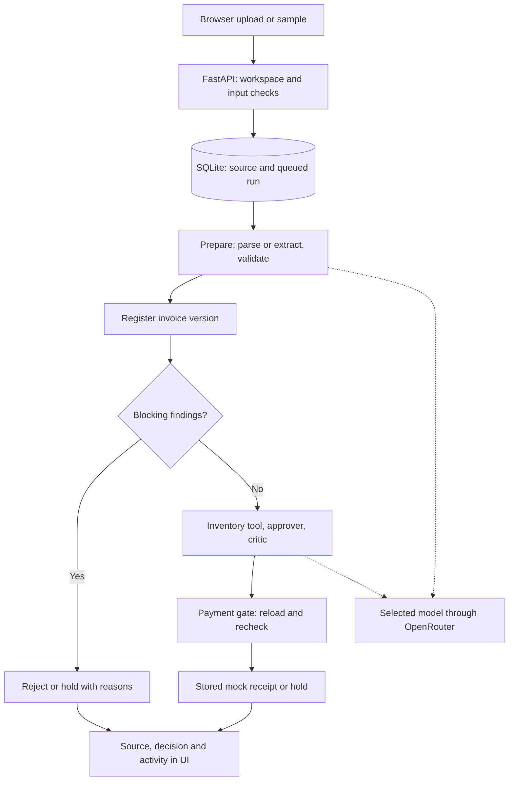

# Architecture

[Live demo](https://invoice-desk-823q.onrender.com/) · [YouTube walkthrough](https://youtu.be/3wwiXjCHQoQ) · [Setup](../README.md#run-locally)

One Python process serves FastAPI, the built React UI and local workers. The CLI and API share `service.py`, policy and SQLite storage.

## Processing

1. **Intake:** enforce file limits; retain source text and original PDF bytes. CSV/JSON/XML use code parsers; TXT/PDF use the reader in live mode. No OCR; scanned content is reported.
2. **Prepare:** extract a typed draft and check required fields, dates, amounts, totals, inventory and suspicious instructions. Repairs need source evidence.
3. **Decide:** register the version, request inventory evidence, then run approver and critic. One revision is allowed. Errors reject; unresolved concerns hold.
4. **Pay:** reload invoice, findings and approval in one SQLite transaction. Check workspace, active version, content hash, policy, currency, identity holds and cancellation. One receipt is allowed per payable.
5. **Follow up:** show the source, findings, outcome and ordered activity. A permitted human decision is checked against the displayed version and hash. Handoffs keep payment on hold.

The agents have separate instructions and checked outputs, but may use the same model. Early blockers or structured inputs can skip stages. The code gate remains the authority for mock payment.

## Models and jobs

The browser selects an approved OpenRouter model. Selection is saved with queued runs and batches and survives restart; one request cannot change another request's model. Keys and endpoints remain server-side. Live failures never fall back to offline responses. Direct xAI and experimental local Ollama are operator-configured alternatives; see [model setup](model-setup.md).

SQLite owns job state. Queued work resumes after restart; running work becomes interrupted and requires an explicit retry. Batches register prepared versions before deciding, so input order cannot authorize the wrong revision. Duplicate request tokens return the same accepted job. Reset refuses active work.

## Workspace and analytics

Signed HttpOnly cookies identify browser workspaces. Queries are workspace-scoped; mutations require same-origin and CSRF checks. Optional demo access codes are shared gates. This is not enterprise sign-in or role management.

Historical charts count attempts. Current backlog selects the latest completed decision for an active version/document; duplicates cannot multiply holds. Paid and superseded invoices leave the backlog. A record can have multiple blocking reasons. SQLite aggregates counts and filters paginated records; cursors use timestamp plus run ID. Pages are read snapshots and may change after a review.

## Code map

| Path | Responsibility |
| --- | --- |
| `src/invoice_flow/api/` | HTTP routes, sessions, job and batch queues. |
| `src/invoice_flow/service.py`, `workflow.py` | Shared processing and LangGraph orchestration. |
| `src/invoice_flow/agents/`, `providers/` | Agent instructions, structured responses and model adapters. |
| `src/invoice_flow/parsers/`, `rules/` | Input handling and independent validation. |
| `src/invoice_flow/ledger.py`, `storage.py` | Version identity, payment gate, SQLite records and events. |
| `frontend/src/` | Invoice inbox, review, handoffs, analytics and reports. |
| `config/policy.yaml` | Thresholds, currency and document limits. |
| `tests/`, `frontend/tests/`, `frontend/e2e/` | Backend, UI and browser checks. |

One Docker service hosts the UI and API on Render. Storage is temporary on the demo. Scaling requires shared durable storage, a distributed queue, worker ownership and global spending/rate controls. [Deployment](deployment.md) · [Tests and evidence](evaluation.md)
