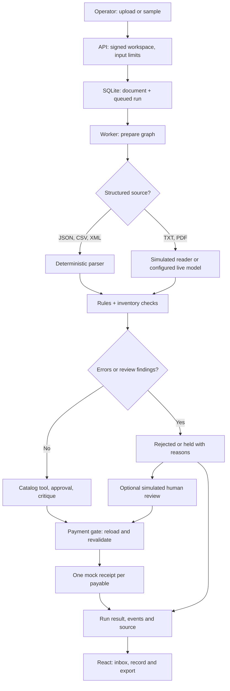

# Architecture and flow

## Scope

Invoice Desk is a single-process prototype. React provides an accounts-payable inbox; FastAPI serves its API and the built frontend. The CLI and API share `service.py`, the same policy and the same SQLite-backed payment gate. Inventory, the VP, the reviewer and payment are simulations.

## Upload and validation

The API checks the filename, extension, size and content; parses structured files directly; and extracts text from TXT and text-based PDF files. The model-facing path returns a typed draft. Rules compare amounts and quoted repairs to the source, aggregate quantities for inventory checks, flag signals and preserve uncertainty. Source matching is not a complete semantic proof. Image-only PDFs do not receive OCR.

## Decisions and payment

A `prepare` graph reads and validates, then a `decide` graph registers the version, uses a narrow catalog tool, collects a simulated approval and critic response, and either holds, rejects or goes to the payment gate. The graph has a bounded request/tool/time budget. Strict tool arguments and typed responses are validated in code.

The gate reloads the stored invoice, findings and approval within a SQLite transaction. It checks workspace, active version, policy fingerprint, content hash, review holds and currency. A uniqueness constraint limits each workspace/payable to one mock receipt. This protects the simulation from duplicate requests; it is not an exactly-once guarantee for a real payment provider.

A human review is explicitly simulated. The UI retrieves server-designated resolvable findings and must send the displayed version and content hash with a note. The server revalidates on submission. Unsupported currency and unorderable revisions cannot be cleared by merely clicking approve.

## State and security

SQLite stores documents as extracted text, runs, ordered events, versions, findings, decisions and simulated receipts. A signed HttpOnly session cookie identifies a demo workspace; same-origin and CSRF checks protect mutations, and queries are scoped to the workspace. The passcode is a shared demo gate, not enterprise identity or access management. A run has a technical lifecycle and a separate business outcome. A browser disconnect does not make a payment or erase the result.

The worker uses one process. Queued runs are recovered after restart; runs that were in progress become interrupted. Batches are not automatically recovered after restart. In-memory rate limiting and the worker are not distributed. Horizontal scaling requires a proper shared database/queue, worker ownership, global rate and cost controls, object storage and safe migration/backups.

## Provider boundary

Mock mode uses a deterministic simulated reader, not a model. Live mode uses OpenRouter over HTTPS with an operator-provided key and configured model. It does not fall back to mock on a live failure. The case requires no internet for external APIs; an actual offline LLM is not implemented. See [evaluation](evaluation.md) for what has and has not been measured.
